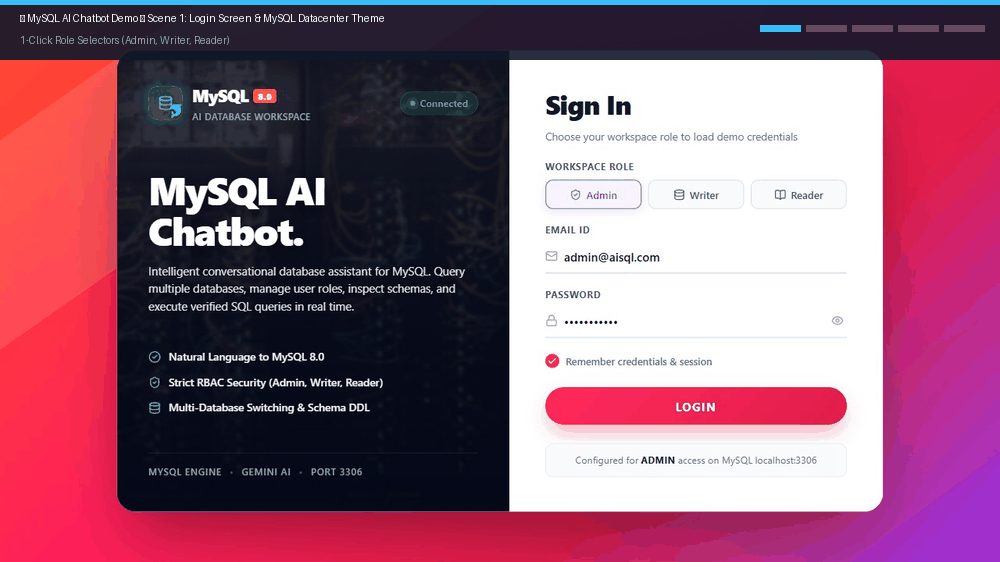
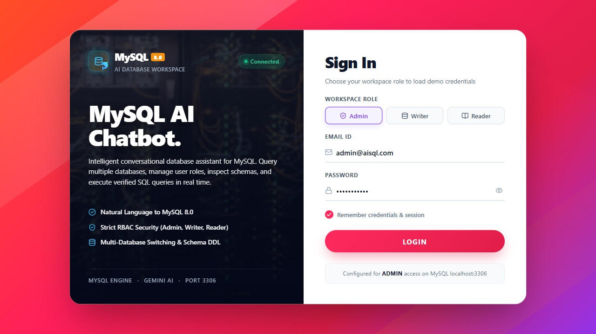
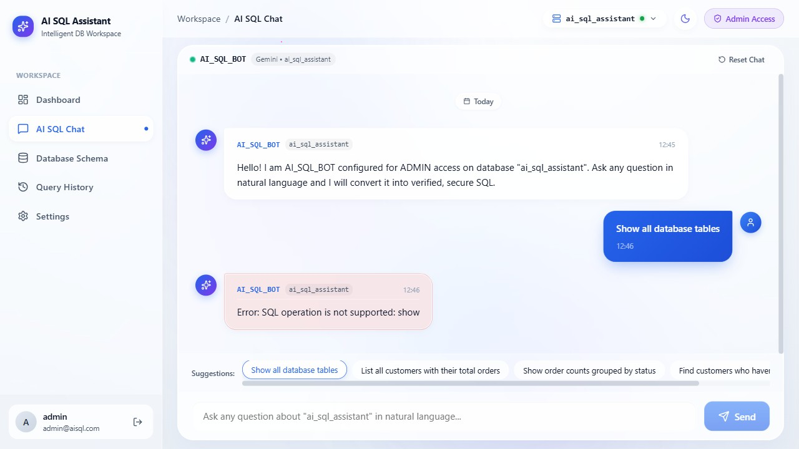
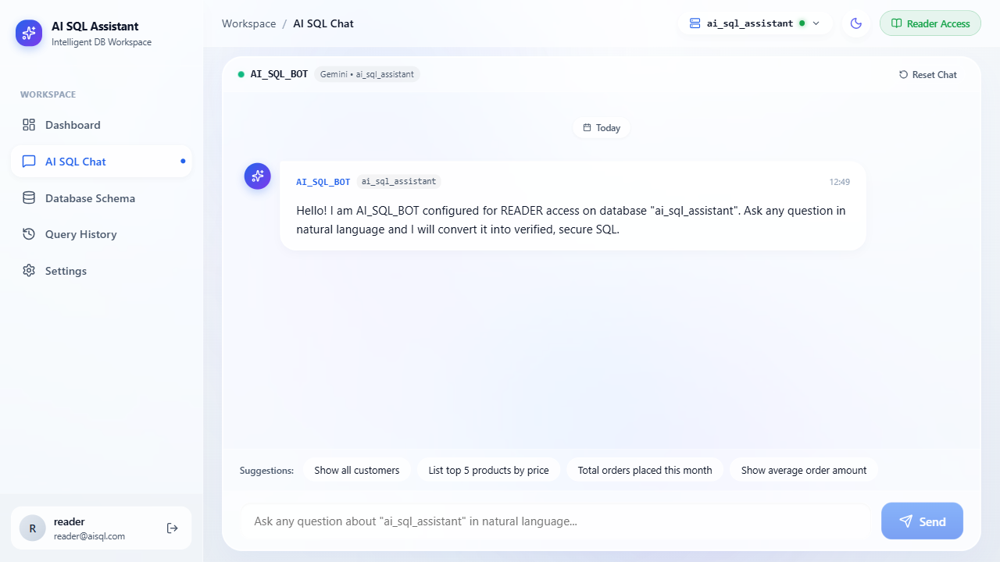
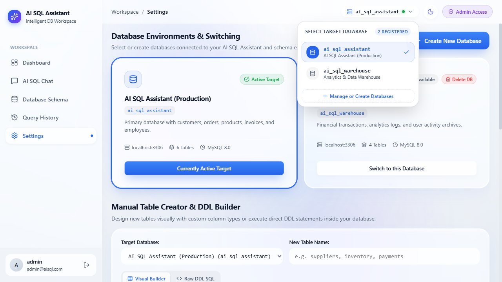
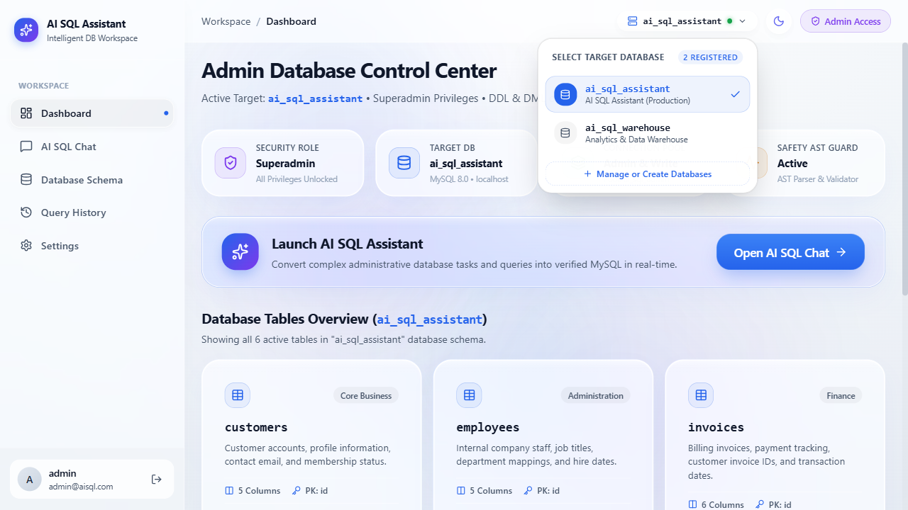
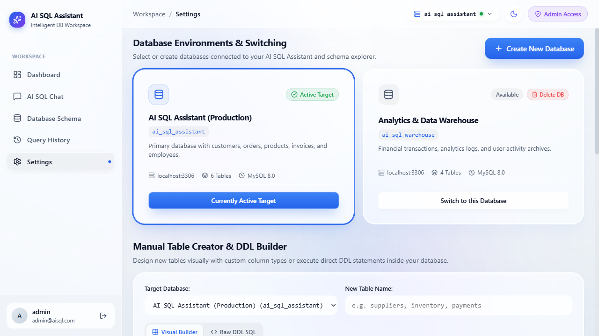
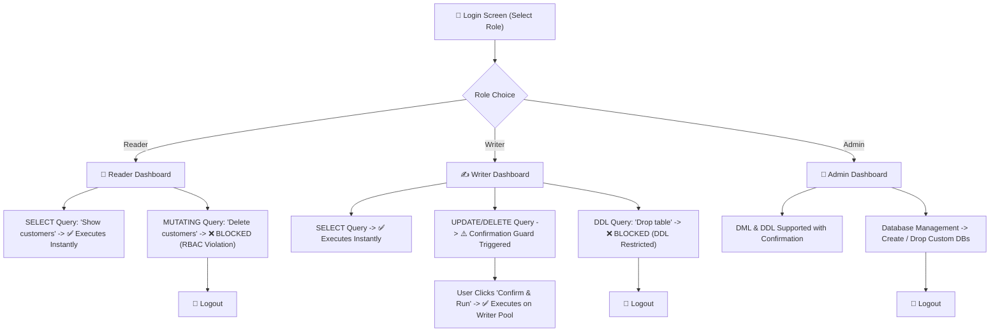

# 🐬 MySQL AI Chatbot — Enterprise SQL Workspace

<div align="center">


**An enterprise-grade, multi-database conversational SQL platform powered by LangChain and Google Gemini LLM.**  
*Natural Language to verified MySQL 8.0 with multi-role RBAC enforcement, AST injection defenses, destructive query confirmation guards, and real-time schema exploration.*

[Live Demo Video](#-live-demo-video-runs-directly-in-readme) • [Key Features](#-key-features) • [LangChain Architecture](#-langchain-integration--architecture) • [Screenshots](#-screenshots--ui-showcase) • [Role Walkthrough](#-end-to-end-role-walkthrough--demo) • [Getting Started](#-getting-started) • [API Reference](#-api-endpoints)

</div>

---

## 🎬 Live Demo Video (Runs Directly in README)

<div align="center">



<p><em>🎥 <strong>Full Animated Walkthrough:</strong> 1-Click Role Login ➔ Reader RBAC Enforcement (SELECT vs Blocked Delete) ➔ Writer Confirmation Guard ➔ Admin Multi-DB Target Switching &amp; Deletion Modal.</em></p>

[](docs/demo-video.html)
[](docs/DEMO_VIDEO_GUIDE.md)

</div>

---

## 🌟 Key Features

- **🧠 Conversational Natural Language to SQL:** Ask questions in plain English or natural language; LangChain and Gemini translate requests into optimized, verified MySQL 8.0 queries.
- **🦜️🔗 LangChain Structured LLM Pipeline:** Uses LangChain's `ChatPromptTemplate` and `withStructuredOutput(Zod)` for deterministic, schema-validated SQL without hallucinated syntax.
- **🛡️ Enterprise Multi-Role RBAC:**
  - **👑 Admin:** Full DDL & DML control (`CREATE`, `ALTER`, `DROP`, `TRUNCATE`, `INSERT`, `UPDATE`, `DELETE`, `SELECT`), database creation and permanent deletion.
  - **✍️ Writer:** Data modification permitted (`SELECT`, `INSERT`, `UPDATE`, `DELETE`). DDL operations are strictly blocked.
  - **📖 Reader:** Strict read-only mode (`SELECT` only, capped at 100 rows). All modifications and drops are blocked.
- **⚠️ Destructive Query Confirmation Guard:**
  - `SELECT` queries execute **seamlessly without extra confirmation**.
  - Destructive/Mutating queries (`DROP`, `TRUNCATE`, `DELETE`, `UPDATE`) trigger an interactive **Confirmation Guard** card requiring explicit user confirmation before touching the database.
- **🔒 AST SQL Injection Defense & Sandboxing:**
  - Parsed via `node-sql-parser` into an Abstract Syntax Tree (AST).
  - Multi-statement execution blocked (`multipleStatements: false`).
  - Dangerous commands (`SELECT INTO`, unindexed Cartesian joins, `WHERE 1=1` bypasses) are neutralized.
  - Connection execution timeout capped at 5000ms (`SET SESSION max_execution_time = 5000`).
- **🗄️ Multi-Database Environments & Switching:**
  - Seamlessly switch active target databases on the fly (`ai_sql_assistant`, `ai_sql_warehouse`, custom user databases).
  - Admin-only database creation and deletion with protected system schemas safeguard.
- **⚡ Production-Grade Security & Performance:**
  - `express-rate-limit` prevents DoS attacks and Gemini API token exhaustion.
  - `helmet` secures HTTP response headers.
  - Granular CORS whitelisting.
- **💎 Apple-Style Glassmorphism UI:**
  - Fluid responsive design for mobile, tablet, and desktop.
  - Typewriter streaming chat, interactive SQL copy/execute, and dynamic tabular result view.

---

## 🦜️🔗 LangChain Integration & Architecture

This project leverages **LangChain Core (`@langchain/core`)** and **Google GenAI (`@langchain/google`)** to establish a structured, safe, and explainable AI-to-SQL execution lifecycle:

```
                      User Natural Language Query
                                  │
                                  ▼
      ┌────────────────────────────────────────────────────────┐
      │   1. Dynamic Schema Introspection (MySQL INFORMATION)  │
      │   Tables, Columns, Data Types, Foreign Keys, Indexes   │
      └───────────────────────────┬────────────────────────────┘
                                  │
                                  ▼
      ┌────────────────────────────────────────────────────────┐
      │   2. LangChain ChatPromptTemplate Context Injection    │
      │   System Instructions + Formatted Schema + Safe Rules  │
      └───────────────────────────┬────────────────────────────┘
                                  │
                                  ▼
      ┌────────────────────────────────────────────────────────┐
      │   3. LangChain withStructuredOutput(ZodSchema)         │
      │   Guaranteed JSON output (SQL, Operation, Explanation) │
      └───────────────────────────┬────────────────────────────┘
                                  │
                                  ▼
      ┌────────────────────────────────────────────────────────┐
      │   4. AST Security & RBAC Parser (node-sql-parser)      │
      │   Multi-Statement Block + Role Permission Verification │
      └───────────────────────────┬────────────────────────────┘
                                  │
                                  ▼
      ┌────────────────────────────────────────────────────────┐
      │   5. LangChain Result Explanation Chain                │
      │   Natural Language Summary & Executive Insights        │
      └────────────────────────────────────────────────────────┘
```

### Why LangChain?
1. **Dynamic Schema Introspection:**
   Instead of hardcoding table lists, LangChain queries `INFORMATION_SCHEMA` in real time, formats columns, primary keys, and foreign keys, and injects this live context into the prompt:
   ```javascript
   const schema = await getDatabaseSchema(targetDb);
   const schemaText = formatSchemaForAI(schema);
   const result = await sqlGenerationChain.invoke({
       schema: schemaText,
       question: question.trim()
   });
   ```

2. **Guaranteed Schema Conformance via Zod:**
   Using `modle.withStructuredOutput(sqlOutputSchema)` with **Zod**, LangChain forces the model to respond strictly with valid JSON conforming to our schema:
   ```javascript
   import { ChatPromptTemplate } from "@langchain/core/prompts";
   import model from "../config/langchain.js";
   import { sqlOutputSchema } from "../schemas/sql-output.schema.js";

   const structuredModel = model.withStructuredOutput(sqlOutputSchema);
   const sqlGenerationChain = sqlGenerationPrompt.pipe(structuredModel);
   ```

3. **Hallucination Prevention:**
   LangChain's prompt enforces that if required values or columns are missing, it returns `operation = "none"` with `needs_clarification = true`, preventing false queries from touching the database.

4. **Multi-Model Flexibility:**
   Because the pipeline is built on LangChain's standard abstractions, switching from Google Gemini to Anthropic Claude or OpenAI GPT requires zero business logic changes.

---

## 📸 Screenshots & UI Showcase

<div align="center">

### 1. Modern Split Showcase Login Screen
*High-tech enterprise datacenter visuals, authentic MySQL 8.0 brand mark, and 1-click workspace role selectors.*



---

### 2. Intelligent AI Chat Workspace & Results Table
*Real-time conversational SQL generation, query explanations, and interactive tabular records viewer.*



---

### 3. Multi-Role RBAC Security Cards
*Assigned roles, permitted query rules, write/DDL guards, and database connection pool separation.*



---

### 4. Database Environments & Instant Target Switching
*Switch between production, analytics warehouse, and user-created databases with live table counts.*

| Database Environment Switcher | Active Tables Schema Overview |
| :---: | :---: |
|  |  |

---

### 5. Database Environments & Admin Management
*Create new databases and manage environments with Admin-Only deletion guards.*



</div>

---

## 🎬 End-to-End Role Walkthrough & Demo

This walkthrough demonstrates the end-to-end security cycle from **Login to Logout** across all three workspace roles.



---

### Role 1: Reader (`reader@aisql.com`) — Strict Read-Only
1. **Sign In:** Click **Reader** role pill on login screen. Credentials auto-fill (`reader@aisql.com` / `password123`).
2. **Safe Query:** Ask *"List all products with price greater than 5000"*.
   - **Result:** ✅ AI generates `SELECT`, executes immediately on `ai_sql_reader` pool, and renders the data table.
3. **Attempt Modification:** Ask *"Delete inactive customers"* or *"Update product price"*.
   - **Result:** ❌ **STRICTLY BLOCKED**. System responds:
     > `Security Policy Violation: Your reader role cannot execute DELETE queries.`
4. **Logout:** Click avatar dropdown -> Sign Out.

---

### Role 2: Writer (`writer@aisql.com`) — Data Operations
1. **Sign In:** Click **Writer** role pill (`writer@aisql.com` / `password123`).
2. **Safe Query:** Ask *"Show total orders placed this week"*.
   - **Result:** ✅ Executes immediately without confirmation.
3. **Destructive/Mutating Query:** Ask *"Delete customers whose status is inactive"*.
   - **Result:** ⚠️ **Confirmation Guard Triggered**. The AI does **not** auto-run the query. A prominent confirmation card appears:
     > `⚠️ Confirmation Required to Run DELETE: This query will alter or remove records in database ai_sql_assistant.`
   - Click **`Confirm & Run DELETE`** -> Query executes securely on `writerDB` pool, returning affected rows count.
4. **Attempt DDL (Drop/Truncate):** Ask *"Drop table orders"*.
   - **Result:** ❌ **STRICTLY BLOCKED**. System responds:
     > `Security Policy Violation: Your writer role cannot execute DROP queries.`
5. **Logout:** Click avatar dropdown -> Sign Out.

---

### Role 3: Admin (`admin@aisql.com`) — Full Control & Management
1. **Sign In:** Click **Admin** role pill (`admin@aisql.com` / `password123`).
2. **Full DDL & DML:** Can run `CREATE TABLE`, `ALTER`, `DROP`, `TRUNCATE`, `INSERT`, `UPDATE`, `DELETE`.
3. **Safety Guard:** Destructive queries (`DROP TABLE`, `TRUNCATE`, `DELETE`) still prompt for confirmation to prevent accidental data loss.
4. **Database Environment Management:**
   - Navigate to **Database Settings**.
   - Click **Create New Database** -> Create a database (e.g. `ecommerce_db`).
   - Create tables visually or via custom DDL.
   - Admin-only **Delete DB** button appears on custom databases with a danger confirmation modal.
   - Primary database `ai_sql_assistant` and system schemas are protected from deletion.
5. **Logout:** Return to login screen.

---

## 🏗️ Technical Architecture

```
                                      ┌─────────────────────────────────────────┐
                                      │        React + Vite Frontend (UI)       │
                                      │  - Liquid Glassmorphic Theme            │
                                      │  - Role Cards & Dynamic Auth Context    │
                                      │  - Typewriter Streaming Chat Workspace  │
                                      └────────────────────┬────────────────────┘
                                                           │ HTTP / Axios (CORS Whitelisted)
                                                           ▼
                                      ┌─────────────────────────────────────────┐
                                      │         Express 5 Backend Security      │
                                      │  - Helmet HTTP Security Headers         │
                                      │  - Express Rate Limiter (Anti-DDoS)     │
                                      │  - 60kb Request Body Size Limiter       │
                                      └────────────────────┬────────────────────┘
                                                           │
                                ┌──────────────────────────┴──────────────────────────┐
                                ▼                                                     ▼
                  ┌───────────────────────────┐                         ┌───────────────────────────┐
                  │    LangChain + Gemini 2.5 │                         │  node-sql-parser (AST)    │
                  │  - Schema Ingestion       │                         │  - Statement Count Check  │
                  │  - Zod Structured Output  │                         │  - Operation Type Guard   │
                  │  - Natural Explanation    │                         │  - WHERE Clause Audit     │
                  └─────────────┬─────────────┘                         └─────────────┬─────────────┘
                                │                                                     │
                                └──────────────────────────┬──────────────────────────┘
                                                           │
                                                           ▼
                                      ┌─────────────────────────────────────────┐
                                      │    RBAC & Connection Pool Router        │
                                      │  - checkSQLPermission(role, operation)  │
                                      │  - Destructive Confirmation Guard       │
                                      └────────────────────┬────────────────────┘
                                                           │
                       ┌───────────────────────────────────┼───────────────────────────────────┐
                       ▼                                   ▼                                   ▼
         ┌───────────────────────────┐       ┌───────────────────────────┐       ┌───────────────────────────┐
         │       Reader Pool         │       │        Writer Pool        │       │        Admin Pool         │
         │  - SELECT Only            │       │  - INSERT, UPDATE, DELETE │       │  - DDL, CREATE, DROP      │
         │  - Max 100 Rows Limit     │       │  - Safe WHERE Enforced    │       │  - Multi-DB Admin Control │
         └─────────────┬─────────────┘       └─────────────┬─────────────┘       └─────────────┬─────────────┘
                       │                                   │                                   │
                       └───────────────────────────────────┼───────────────────────────────────┘
                                                           ▼
                                      ┌─────────────────────────────────────────┐
                                      │             MySQL 8.0 Server            │
                                      │  Port: 3306 • max_execution_time=5000ms │
                                      └─────────────────────────────────────────┘
```

---

## 🚀 Getting Started

### Prerequisites
- **Node.js**: v18.0.0 or higher
- **MySQL Server**: v8.0 or higher
- **Google Gemini API Key**: [Get API Key](https://aistudio.google.com/)

---

### 1. Clone the Repository
```bash
git clone https://github.com/chinmayrane-491/AI_SQL_Assistant.git
cd AI_SQL_Assistant
```

---

### 2. Backend Setup
```bash
cd backend
npm install
```

Create a `.env` file inside `backend/` (use `.env.example` as reference):
```env
# Server
PORT=5000
CLIENT_URL=http://localhost:5173

# Primary MySQL Database
DB_HOST=localhost
DB_PORT=3306
DB_USER=root
DB_PASSWORD=your_mysql_password
DB_NAME=ai_sql_assistant

# Google Gemini API
GEMINI_API_KEY=your_gemini_api_key_here
GEMINI_MODEL=gemini-2.5-flash

# Connection Pools (Can use root for local dev, or dedicated users for production)
READ_DB_HOST=localhost
READ_DB_USER=ai_sql_reader
READ_DB_PASSWORD=your_reader_password
READ_DB_NAME=ai_sql_assistant

DB_READER_USER=ai_sql_reader
DB_READER_PASSWORD=your_reader_password

DB_WRITER_USER=ai_sql_writer
DB_WRITER_PASSWORD=your_writer_password

DB_ADMIN_USER=ai_sql_admin
DB_ADMIN_PASSWORD=your_admin_password
```

Start the backend server:
```bash
npm run dev
```
Backend will start on `http://localhost:5000`.

---

### 3. Frontend Setup
Open a new terminal window:
```bash
cd frontend
npm install
npm run dev
```
Frontend will start on `http://localhost:5173`.

---

## 🔑 Demo Credentials

| Role | Email | Password | Access Level |
|---|---|---|---|
| **👑 Admin** | `admin@aisql.com` | `password123` | Full DDL & DML, DB Creation/Deletion |
| **✍️ Writer** | `writer@aisql.com` | `password123` | SELECT, INSERT, UPDATE, DELETE (Confirmation Guard) |
| **📖 Reader** | `reader@aisql.com` | `password123` | Strict Read-Only (SELECT Max 100 Rows) |

---

## 📡 API Endpoints

| Method | Endpoint | Description | Rate Limit |
|---|---|---|---|
| `POST` | `/api/ask` | Natural language question -> Generates SQL, executes SELECT or prompts confirmation for mutations | 30 req/min |
| `POST` | `/api/execute-confirmed` | Executes confirmed DML/DDL queries after user verification | 30 req/min |
| `GET` | `/api/schema` | Retrieves tables, columns, keys and relations for target database | 200 req/15min |
| `GET` | `/api/databases` | Lists non-system user databases | 200 req/15min |
| `POST` | `/api/database/create` | Creates a new MySQL database | 200 req/15min |
| `POST` | `/api/database/delete` | Permanently drops a database (Admin only) | 200 req/15min |
| `POST` | `/api/table/create` | Creates a table via visual builder or custom DDL | 200 req/15min |
| `GET` | `/api/health` | Backend server health check & status | Unlimited |

---

## 📄 License
This project is licensed under the [ISC License](LICENSE).

<div align="center">
  <sub>Built with ❤️ by <strong>Chinmay</strong> using LangChain, Google Gemini &amp; MySQL</sub>
</div>
